# Synthetic Data Pipelines

Companion repository for two studies by Bhavin Kotak (`bhavin.kotak@ibm.com` | `kotak.bhavin@gmail.com`) on orchestrated synthetic tabular data generation, fidelity and privacy gates, and downstream training utility.



Interactive HTML version: [`docs/diagrams/synthetic-data-flow.html`](./docs/diagrams/synthetic-data-flow.html)

<!-- v2-release -->
## Version 2.0 study (November 2026)

Version 2.0 is a preregistered benchmark on four public tabular classification datasets (`breast_cancer`, `credit_g`, `adult`, `bank_marketing`): *From Data Scarcity to Abundance? A Reproducible Benchmark of Quality-Gated Synthetic Data Pipelines for Tabular Model Training* ([`v2/paper/main.pdf`](v2/paper/main.pdf)).

- Code, preregistration, logged runs, and tests: [`v2/`](v2/)
- Zenodo archive: [10.5281/zenodo.20619633](https://doi.org/10.5281/zenodo.20619633) (v1: [10.5281/zenodo.18445584](https://doi.org/10.5281/zenodo.18445584))
- Preregistered verdict: `SUPPORTED` (4 of 4 datasets, 0 abstentions)
- Key logged results: a rule-orchestrated candidate list (Gaussian copula, class-conditional GMM, SMOTE-style interpolation, independent marginals) behind a fail-closed quality gate (`<= 2x` real-holdout 95th-percentile marginal and correlation distances, Gower L1 distance-to-closest-record share `<= 0.60`) reaches mean TSTR/TRTR `HistGradientBoosting` ROC-AUC ratios of `99.6%` (`breast_cancer`), `96.1%` (`credit_g`), `99.0%` (`adult`), and `96.2%` (`bank_marketing`), with mean DCR share `0.50` to `0.53`. When a leaky copy generator is placed first, the gate holds membership-inference AUC to `<= 0.55` across all four datasets versus `0.66` to `0.82` ungated (S1), and retry-plus-fallback delivers `>= 98%` of requested rows at a `30%` generator fault rate (S3).
- Reproduce everything: `python v2/code/run_all.py` and `pytest v2/tests/test_pipeline.py -v`

Every number in the v2 paper comes directly from logged outputs in `v2/results/`. Unsupported v1 claims were removed and listed in [`v2/REVIEW.md`](v2/REVIEW.md).
<!-- v2-release -->

## Reference library (`src/`)

The `src/` package contains the v1 financial transaction synthesis and validation code (*From Data Scarcity to Abundance: Scaling Model Training with LLM-Orchestrated Synthetic Data Pipelines*): `TransactionGenerator` and `SyntheticDataQualityValidator` covering statistical fidelity, range coverage, downstream ROC-AUC utility, and membership-inference checks.

## Project layout

```
synthetic-data-pipelines/
├── docs/diagrams/                  # Editorial decision-flow diagram (.html + .svg)
├── v2/
│   ├── code/sdp/                   # Class-conditional generators, QualityGate, orchestrator
│   ├── code/run_all.py             # End-to-end v2 reproduction entrypoint
│   ├── paper/                      # LaTeX source and compiled main.pdf
│   ├── preregistration.json        # Locked hypotheses and gate constants
│   ├── results/                    # Logged CSV/JSON outputs and verdict.json
│   └── tests/test_pipeline.py      # Unit tests for gate and orchestrator
├── src/
│   ├── synthetic_data_generator.py # TransactionGenerator, SyntheticDataQualityValidator
│   └── pdf_generator.py            # Markdown-to-PDF helper
├── tests/test_synthetic_data.py    # Unit tests for src/
└── requirements.txt
```

## Installation

```bash
python -m venv venv
source venv/bin/activate
pip install -r requirements.txt
```

## Quick start (`src/`)

```python
from src.synthetic_data_generator import (
    SyntheticDataConfig,
    TransactionGenerator,
    SyntheticDataQualityValidator
)

config = SyntheticDataConfig(
    n_samples=10000,
    fraud_rate=0.02,
    random_seed=42
)

generator = TransactionGenerator(config)
synthetic_data = generator.generate_dataset()

validator = SyntheticDataQualityValidator(real_data, synthetic_data)
report = validator.generate_full_report()
```

## Running studies and tests

```bash
# Reproduce the v2 benchmark and run v2 tests
python v2/code/run_all.py
pytest v2/tests/test_pipeline.py -v

# Run v1 demo and unit tests
python src/synthetic_data_generator.py
pytest tests/test_synthetic_data.py -v
```

## Evaluation dimensions

| Dimension | v2 benchmark (`v2/code/sdp/`) | v1 validator (`src/`) |
|-----------|-------------------------------|-----------------------|
| Schema & faults | Strict column/NaN check + fail-closed retry/fallback (`gate.py`) | `generation_stats` error counts |
| Statistical fidelity | Holdout-calibrated marginal + correlation distances (`<= 2x q95`) | Wasserstein distance & two-sample KS |
| Downstream utility | Stratified TSTR / TRTR `HistGradientBoosting` ROC-AUC ratio | Random Forest / GBDT ROC-AUC comparison |
| Privacy | Gower L1 nearest-neighbor `dcr_share <= 0.60` + MIA AUC audit | Distance-based membership inference check |

## Citation

```bibtex
@misc{kotak2026synthetic_v2,
  title  = {From Data Scarcity to Abundance? A Reproducible Benchmark of Quality-Gated Synthetic Data Pipelines for Tabular Model Training},
  author = {Kotak, Bhavin},
  year   = {2026},
  doi    = {10.5281/zenodo.20619633},
  url    = {https://doi.org/10.5281/zenodo.20619633}
}
```

## License

MIT License.
